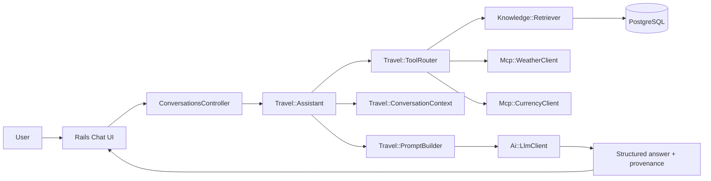

# AI Travel Planning Assistant

Production-oriented Ruby on Rails app for Singapore travel planning with RAG, semantic retrieval, current weather and currency tooling, multi-turn memory, and source-aware responses.

## Overview

The app answers Singapore travel questions using three grounded inputs:

- A curated Singapore knowledge base stored in PostgreSQL.
- Current weather data via a weather tool adapter.
- Current currency conversion via a currency tool adapter.

It keeps conversations stateful so follow-up questions such as "what if it rains on day two?" keep the same trip context.

## Architecture



### Design choices

- Rails 7.2 for the web layer and orchestration.
- PostgreSQL for persistence.
- Semantic retrieval implemented in Ruby over embeddings stored as float arrays, which keeps the app runnable without a separate vector service.
- Service objects isolate orchestration, retrieval, prompting, and tool adapters.
- The UI is intentionally simple and readable on desktop and mobile.

## Project Structure

- [app/services/travel/assistant.rb](app/services/travel/assistant.rb)
- [app/services/travel/tool_router.rb](app/services/travel/tool_router.rb)
- [app/services/travel/conversation_context.rb](app/services/travel/conversation_context.rb)
- [app/services/travel/prompt_builder.rb](app/services/travel/prompt_builder.rb)
- [app/services/knowledge/importer.rb](app/services/knowledge/importer.rb)
- [app/services/knowledge/retriever.rb](app/services/knowledge/retriever.rb)
- [app/services/mcp/weather_client.rb](app/services/mcp/weather_client.rb)
- [app/services/mcp/currency_client.rb](app/services/mcp/currency_client.rb)
- [app/services/ai/open_ai_client.rb](app/services/ai/open_ai_client.rb)
- [app/controllers/conversations_controller.rb](app/controllers/conversations_controller.rb)
- [app/controllers/messages_controller.rb](app/controllers/messages_controller.rb)
- [app/views/conversations/show.html.erb](app/views/conversations/show.html.erb)

## Knowledge Base

The knowledge base contains three Singapore public resources curated into chunks:

1. Wikivoyage Singapore Travel Guide
	- URL: https://en.wikivoyage.org/wiki/Singapore
	- Extracted: neighborhoods, transport, food, culture, indoor/outdoor highlights.
2. Visit Singapore - Things to Do
	- URL: https://www.visitsingapore.com/en/see-do/
	- Extracted: must-visit attractions, family-friendly ideas, indoor backups, outdoor planning.
3. Visit Singapore - Travel Planning and Itineraries
	- URL: https://www.visitsingapore.com/en/plan-your-trip/
	- Extracted: three-day planning patterns, transport, budget and weather backups.

### Ingestion process

The importer flow is:

1. `Knowledge::Catalog` defines the curated source list.
2. `Knowledge::Chunker` turns each source into meaningful sections.
3. `Knowledge::Embedder` creates a deterministic embedding vector for each chunk.
4. `Knowledge::Importer` persists `KnowledgeSource` and `KnowledgeChunk` rows.
5. `Knowledge::Retriever` ranks chunks by cosine similarity.

### Chunking notes

Chunks are section-sized, not arbitrary character slices. Each chunk retains metadata with:

- source title
- source URL
- destination
- section title

## MCP Integrations

The app includes two tool adapters:

- `Mcp::WeatherClient`
- `Mcp::CurrencyClient`

They normalize external responses into app-level hashes with `status`, `data`, and `error` fields.

### Weather

Weather is used for current or forecast-based questions and for itinerary adjustments such as rain-friendly plans. If the MCP endpoint is unavailable, the client falls back to a public forecast source so the app remains usable during local development.

### Currency

Currency conversion is used for current INR-to-SGD, SGD-to-INR, or USD-to-SGD requests. The adapter normalizes the result into a current conversion payload.

### Tool selection

`Travel::ToolRouter` decides whether a request needs:

- knowledge only
- weather only
- currency only
- knowledge + weather
- knowledge + currency
- knowledge + weather + currency

## Prompt Strategy

`Travel::PromptBuilder` uses a layered prompt design:

- system rules that require grounding and forbid unsupported facts
- the current conversation context, including preserved user preferences
- retrieved knowledge snippets for destination facts
- tool results for current weather and currency data
- recent conversation history for follow-up continuity

For combined requests, the response is instructed to separate:

- knowledge-base facts
- current tool data
- AI recommendations

This keeps the answer auditable and prevents current information from being presented as stable destination knowledge.

## Technology Requirements

The app is built around the requested AI workflow capabilities, with a Rails-native orchestration layer in place of a separate LangChain dependency:

- Application orchestration: `Travel::Assistant`, `Travel::ToolRouter`, `Travel::ConversationContext`, and `Travel::PromptBuilder`
- Embeddings: the deterministic Ruby embedder in `Knowledge::Embedder`
- Vector store: PostgreSQL-backed semantic retrieval over stored embeddings, with `pgvector` available in the stack for vector-oriented storage and search
- LLM: the configurable `Ai::LlmClient` interface, with a local fallback client for development and testing
- MCP tools: `Mcp::WeatherClient` and `Mcp::CurrencyClient`
- User interface: a simple Rails chat UI built with Turbo and Stimulus

This keeps the project focused on AI workflow quality, grounding, and tool integration rather than UI complexity.

## Rails Console Sample

The assistant is used by the Rails chat UI, and developers can also exercise the same orchestration path directly from `rails c`.

```ruby
conversation = Conversation.create!

result = Travel::Assistant.call(
  conversation: conversation,
  user_message: "Create a three-day Singapore itinerary for next week and adjust it according to the weather forecast."
)

puts result.answer
puts result.sources
puts result.tools
```

For a combined budget scenario, you can run:

```ruby
conversation = Conversation.create!

result = Travel::Assistant.call(
  conversation: conversation,
  user_message: "I have a budget of INR 60,000. Convert it to SGD and suggest a three-day itinerary."
)

puts result.answer
```

If you want to inspect the persisted message and provenance, use:

```ruby
conversation.messages.last.metadata
```

## Conversation Memory

The app stores both messages and structured preferences:

- destination
- travel party
- children ages
- budget and currency
- trip duration
- travel window
- previous itinerary summary

This supports follow-up questions without repeating the full trip brief.

## Setup

```bash
bundle install
bin/rails db:create db:migrate
bin/rails knowledge:import
bin/rails server
```

## Environment Variables

Create a local `.env` or export the following variables:

- `LLM_API_KEY`
- `LLM_MODEL`
- `LLM_BASE_URL`
- `WEATHER_MCP_URL`
- `CURRENCY_MCP_URL`

The app will use a local fallback client when no LLM key is configured.

## Knowledge Ingestion

Use either of these commands:

```bash
bin/rails knowledge:import
```

or:

```bash
bin/rails db:seed
```

Both load the Singapore knowledge base into PostgreSQL.

## Testing

```bash
bundle exec rspec
bundle exec rubocop
bundle exec brakeman
```

## Sample Demo Scenarios

### RAG only

```text
What are the must-visit attractions in Singapore?
```

### Weather only

```text
What is the weather forecast for Singapore next week?
```

### Currency only

```text
Convert INR 50,000 to SGD.
```

### RAG + Weather

```text
Create a three-day Singapore itinerary for next week and adjust it according to the weather forecast.
```

### RAG + Currency

```text
I have INR 60,000. Plan a three-day Singapore trip and show the equivalent SGD amount.
```

### Multi-turn conversation

```text
I'm travelling with my wife and 8-year-old son.
```

```text
Plan three days for us in Singapore.
```

```text
What if it rains on day two?
```

### Failure behavior

```text
What are the best neighbourhoods in Singapore?
```

If the knowledge base is insufficient, the assistant says so instead of inventing facts. If a tool fails, the assistant discloses the failure and continues with safe grounded content.

## Response Provenance

Assistant messages include visible provenance in the UI:

- knowledge source titles and URLs
- tool usage status

That makes the workflow auditable and easy to test.

## Assignment Compliance Snapshot

| Assignment Requirement | Implementation | Test | Status |
|---|---|---|---|
| RAG-based destination retrieval | `Knowledge::Retriever` | `spec/services/knowledge/retriever_spec.rb` | Done |
| Semantic/vector search | deterministic embeddings + cosine similarity | `spec/services/knowledge/retriever_spec.rb` | Done |
| Weather MCP integration | `Mcp::WeatherClient` | `spec/services/mcp/weather_client_spec.rb` | Done |
| Currency MCP integration | `Mcp::CurrencyClient` | `spec/services/mcp/currency_client_spec.rb` | Done |
| RAG + MCP combined workflows | `Travel::Assistant` | `spec/services/travel/assistant_spec.rb` | Done |
| Multi-turn conversational context | `Travel::ConversationContext` | `spec/services/travel/conversation_context_spec.rb` | Done |
| Appropriate tool selection | `Travel::ToolRouter` | `spec/services/travel/tool_router_spec.rb` | Done |
| Source/provenance information | message metadata + UI source list | `spec/services/travel/assistant_spec.rb` | Done |
| Graceful failure handling | assistant rescue path + tool clients | `spec/services/travel/assistant_spec.rb` | Done |
| Prompt engineering | `Travel::PromptBuilder` | covered by assistant workflow spec | Done |

## Minimum Acceptance Criteria

- [x] Knowledge base created from at least three travel resources
- [x] Embedding-based semantic retrieval
- [x] Grounded answers with source references
- [x] Weather information through an MCP tool
- [x] Currency conversion through an MCP tool
- [x] At least one response combining RAG and MCP
- [x] Multi-turn conversation with retained context
- [x] Appropriate tool selection based on user intent
- [x] Clear handling of missing knowledge and tool failures
- [x] A simple, usable interface

## Deliverables

1. Source code in a Git repository
  - This project is tracked as a standard Rails application with service objects, specs, and documentation.
2. A working application
  - The app runs as a Rails web application and serves a conversational travel assistant UI.
3. Knowledge-base documents, or clear instructions for obtaining them
  - The Singapore knowledge base sources are listed in the README, and `bin/rails knowledge:import` / `bin/rails db:seed` load them.
4. A README covering architecture, knowledge-base sources, RAG workflow, MCP tools, prompt and context strategy, and setup instructions
  - The sections above document all of these areas.
5. Sample questions and application responses
  - The README includes sample questions for RAG, weather, currency, combined scenarios, and multi-turn context.
6. A short demonstration showing RAG, MCP, a combined response, and conversational context
  - Use the console examples below or the sample questions in the README to exercise each scenario.

## Sample Questions and Example Response Shapes

These are representative prompts and the type of response the assistant is designed to return:

| Prompt | Expected response shape |
|---|---|
| `What are the must-visit attractions in Singapore?` | Grounded destination summary with source titles and URLs |
| `What is the weather forecast for Singapore next week?` | MCP weather summary |
| `Convert INR 50,000 to SGD.` | MCP currency conversion result |
| `Create a three-day Singapore itinerary for next week and adjust it according to the weather forecast.` | Combined RAG + weather itinerary with indoor backup guidance |
| `I'm travelling with my wife and 8-year-old son.` followed by `Plan three days for us in Singapore.` | Multi-turn response that preserves family context |

## Short Demonstration

Run these in `rails c` to see the main workflows end to end:

```ruby
conversation = Conversation.create!
Travel::Assistant.call(
  conversation: conversation,
  user_message: "What are the must-visit attractions in Singapore?"
)
```

```ruby
conversation = Conversation.create!
Travel::Assistant.call(
  conversation: conversation,
  user_message: "What is the weather forecast for Singapore next week?"
)
```

```ruby
conversation = Conversation.create!
Travel::Assistant.call(
  conversation: conversation,
  user_message: "Create a three-day Singapore itinerary for next week and adjust it according to the weather forecast."
)
```

```ruby
conversation = Conversation.create!
Travel::Assistant.call(
  conversation: conversation,
  user_message: "I'm travelling with my wife and 8-year-old son."
)

Travel::Assistant.call(
  conversation: conversation,
  user_message: "Plan three days for us in Singapore."
)
```
| Tests | RSpec suite | `bundle exec rspec` | Done |
| README/documentation | this file | n/a | Done |
| Simple usable UI | chat view and layout | manual UI smoke | Done |

## Known Limitations

- The app uses a portable Ruby cosine-similarity implementation instead of PostgreSQL `pgvector` so it runs reliably in this environment without extra database extension setup.
- The LLM adapter is configurable and defaults to a local deterministic responder when no API key is provided.
- Weather and currency clients are adapter-based and can be pointed at MCP-compatible endpoints through environment variables.


